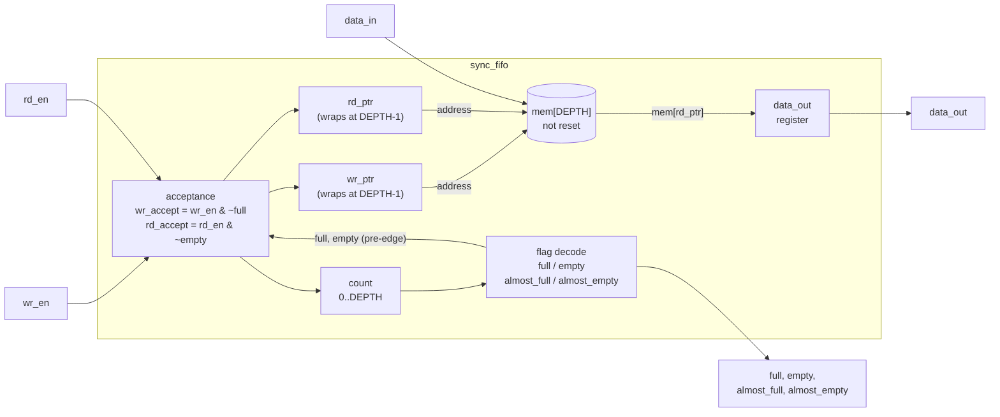
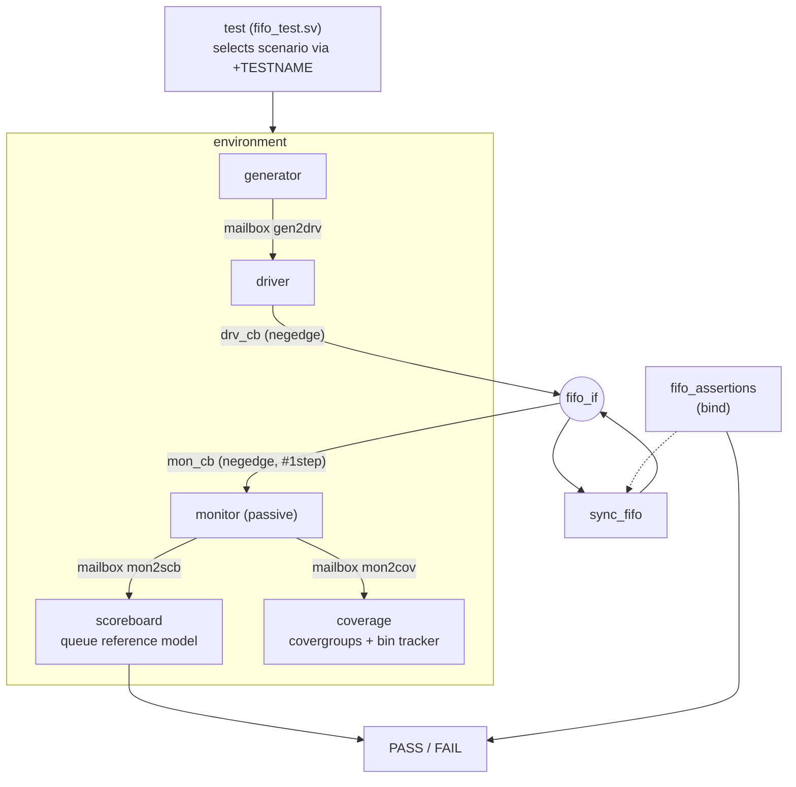
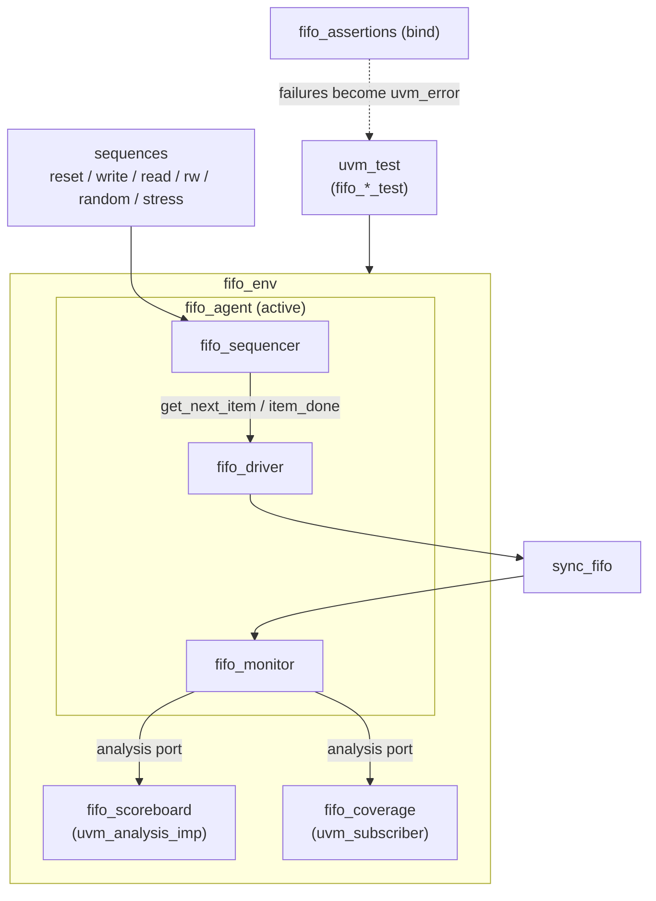

# Parameterized Synchronous FIFO — Design Verification

A small IP-verification project: a parameterized single-clock FIFO and two
testbenches for the same RTL.

1. **Phase 1 – SystemVerilog class-based layered testbench**: generator,
   driver, passive monitor, queue-based scoreboard, functional coverage,
   SVA, directed + constrained-random + stress tests, multi-configuration
   regression.
2. **Phase 2 – UVM testbench**: the same verification concepts restructured
   into UVM components, sequences, an agent, analysis ports, factory
   registration, `uvm_config_db`, phases and objections.

The RTL is deliberately simple; the point of the project is the verification
methodology.

### Results at a glance

| | |
|---|---|
| RTL | lint-clean (Verilator `-Wall`, Icarus) and synthesizable (Yosys, no latches) in 5 configurations |
| SV testbench regression | **105/105 runs pass** on Verilator 5.048: 14 tests x 5 parameter configurations, random tests x 3 seeds, 10k-cycle stress x 2 seeds (153,414 checked cycles) |
| Functional coverage | 73/73 `fifo_cg` bins and 3/3 reset bins hit in every configuration (merged over the regression) |
| Bug detection | **12/12 injected RTL bugs caught** by mutation testing (one of them only at DEPTH=10: at DEPTH=16 it is functionally equivalent) |
| Assertions | 18 SVA properties + 9 cover properties, bound to the DUT, 0 failures on the correct RTL |
| UVM testbench | complete; elaborates with 0 errors against Accellera UVM 2020.3.1 in all 5 configurations; **not yet simulated** (see [Known limitations](#10-known-limitations)) |

---

## Contents

1. [Project overview](#1-project-overview)
2. [DUT specification](#2-dut-specification)
3. [Block diagram](#3-block-diagram)
4. [Testbench architecture](#4-testbench-architecture)
5. [Verification components](#5-verification-components)
6. [Test scenarios](#6-test-scenarios)
7. [Results: regression, functional coverage, mutation testing](#7-results-regression-functional-coverage-mutation-testing)
8. [Assertion summary](#8-assertion-summary)
9. [Simulation commands](#9-simulation-commands)
10. [Known limitations](#10-known-limitations)

---

## 1. Project overview

```
fifo_dv_project/
├── rtl/
│   └── sync_fifo.sv              synthesizable DUT
├── sv_tb/                        Phase 1: class-based layered testbench
│   ├── fifo_interface.sv         interface + driver/monitor clocking blocks
│   ├── fifo_tb_pkg.sv            package (configuration + `include of the classes)
│   ├── fifo_transaction.sv       one FIFO operation, constraints
│   ├── fifo_generator.sv         directed building blocks + constrained random
│   ├── fifo_driver.sv            transaction -> pins (falling edge)
│   ├── fifo_monitor.sv           pins -> observed transaction (passive)
│   ├── fifo_scoreboard.sv        independent queue reference model
│   ├── fifo_coverage.sv          covergroups + log bin tracker
│   ├── fifo_assertions.sv        SVA, bound into the DUT (shared with UVM)
│   ├── fifo_environment.sv       builds and connects the components
│   ├── fifo_test.sv              14 tests + test factory
│   └── tb_top.sv
├── uvm_tb/                       Phase 2: UVM testbench
│   ├── fifo_if.sv, fifo_pkg.sv, tb_top.sv
│   ├── agents/      sequence item, sequencer, driver, monitor, agent
│   ├── sequences/   base, reset, idle, write, read, rw, random, stress
│   ├── env/         env, scoreboard, coverage (uvm_subscriber)
│   └── tests/       base, basic, 8 directed, 4 random/stress
├── scripts/
│   ├── run_sv.sh / run_uvm.sh    compile + run one test
│   ├── regression.sh             tests x configs x seeds, summary + merged coverage
│   ├── mutation_test.sh          injects 12 RTL bugs, checks the testbench catches them
│   ├── synth_yosys.sh            synthesizability check
│   ├── common.sh, coverage_report.py, mutate_rtl.py
└── results/summary/              committed results of the runs reported below
```

Simulators: the scripts support **Verilator, Questa, VCS and Xcelium**
(`--sim`). All results in this README were produced with **Verilator 5.048**;
see [Known limitations](#10-known-limitations) for what was and was not run.

---

## 2. DUT specification

### 2.1 Interface

| Signal | Dir | Width | Description |
|---|---|---|---|
| `clk` | in | 1 | Clock |
| `rst_n` | in | 1 | Active-low **synchronous** reset |
| `wr_en` | in | 1 | Write request |
| `rd_en` | in | 1 | Read request |
| `data_in` | in | `DATA_WIDTH` | Write data |
| `data_out` | out | `DATA_WIDTH` | Registered read data |
| `full` | out | 1 | `count == DEPTH` |
| `empty` | out | 1 | `count == 0` |
| `almost_full` | out | 1 | `count >= ALMOST_FULL_LEVEL` |
| `almost_empty` | out | 1 | `count <= ALMOST_EMPTY_LEVEL` |

| Parameter | Default | Legal range (checked at elaboration) |
|---|---|---|
| `DATA_WIDTH` | 8 | ≥ 1 |
| `DEPTH` | 16 | ≥ 2, any value (not only powers of two) |
| `ALMOST_FULL_LEVEL` | 14 | 1 … `DEPTH` |
| `ALMOST_EMPTY_LEVEL` | 1 | 0 … `DEPTH-1` |

### 2.2 Operation semantics

Acceptance is decided from the flags **immediately before** the clock edge:

```
wr_accept = wr_en & ~full        rd_accept = rd_en & ~empty

count_next = count + 1   if wr_accept & ~rd_accept
             count - 1   if rd_accept & ~wr_accept
             count       otherwise
```

| Condition | Behaviour |
|---|---|
| write, not full | write |
| read, not empty | read |
| write + read, partially full | both |
| write while full | ignored (no pointer/occupancy change, data intact) |
| read while empty | ignored (`data_out` holds) |
| write + read while full | read only |
| write + read while empty | write only |
| no request | hold |
| `rst_n = 0` | pointers, occupancy and `data_out` cleared; reset beats requests |

`data_out` is registered: it loads the oldest entry on an accepted read and
otherwise holds its value; reset sets it to 0. The storage array is not reset.

---

## 3. Block diagram



All flags are combinational decodes of the registered occupancy counter, so
they change only on clock edges. Sequential state is updated from separate
`always_comb` next-state blocks; both pointers wrap explicitly, which is
what makes non-power-of-two depths work.

Synthesis with Yosys (`scripts/synth_yosys.sh`, generic gates, `check -assert`)
shows no latches and the expected flop split:

| Config | Cells | Flops with sync reset (pointers + count + data_out) | Storage flops (not reset) | Result |
|---|---|---|---|---|
| `small` (W=8 D=4) | 110 | 15 | 32 | OK |
| `default` (W=8 D=16) | 375 | 21 | 128 | OK |
| `wide` (W=32 D=16) | 1143 | 45 | 512 | OK |
| `deep` (W=8 D=64) | 1303 | 27 | 512 | OK |
| `npot` (W=8 D=10) | 252 | 20 | 80 | OK |

---

## 4. Testbench architecture

### 4.1 Phase 1 – layered SystemVerilog testbench



Two independent paths: **stimulus** (test → generator → driver → DUT) and
**observation** (DUT → monitor → scoreboard + coverage). The monitor never
looks at the driver.

**Clocking strategy (race-free, no ad-hoc delays).**

```
             drv_cb drives       DUT samples         mon_cb samples
             request N           request N           request N + result
                 |                   |                    |
  clk  __________|‾‾‾‾‾‾‾‾‾|_________|‾‾‾‾‾‾‾‾‾|__________|‾‾‾‾‾‾‾‾‾
              negedge             posedge              negedge
```

The driver applies a request on the falling edge. The monitor samples on the
falling edge with `#1step` input skew, so it sees the request the DUT consumed
at the preceding rising edge *and* the outputs that edge produced, before the
driver changes anything. One monitor sample = one complete operation, which
is exactly the pairing the scoreboard needs (e.g. FIFO `[A,B,C]`, write+read
of `D` → next sample shows `data_out=A`, model becomes `[B,C,D]`).

### 4.2 Phase 2 – UVM testbench



| SystemVerilog testbench | UVM equivalent in this repo |
|---|---|
| `fifo_transaction` | `fifo_sequence_item` (`uvm_object_utils`, `do_copy`, `do_compare`, `convert2string`) |
| generator | sequences (`fifo_*_sequence`), late randomization in `start_item`/`finish_item` |
| generator→driver mailbox | `fifo_sequencer` |
| driver | `fifo_driver` (`uvm_driver`, `get_next_item()` / `item_done()`) |
| monitor + mailboxes | `fifo_monitor` (`uvm_monitor`) + `uvm_analysis_port` |
| scoreboard | `fifo_scoreboard` (`uvm_scoreboard`, `uvm_analysis_imp`) |
| coverage | `fifo_coverage` (`uvm_subscriber`) |
| environment | `fifo_env` (`uvm_env`) + `fifo_agent` (`uvm_agent`) |
| test factory (`+TESTNAME`) | UVM factory (`+UVM_TESTNAME`, `type_id::create`) |
| constructors / `start()` | `build_phase`, `connect_phase`, `run_phase`, `report_phase`, `final_phase` |
| `wait_for_completion()` | objections (`raise_objection` / `drop_objection`) |
| virtual interface by constructor | `uvm_config_db #(virtual fifo_if #(DATA_WIDTH))` |

---

## 5. Verification components

| Component | What it does | Notes |
|---|---|---|
| Interface | DUT signals, `drv_cb` (negedge outputs), `mon_cb` (negedge, `#1step` inputs) | same strategy in both testbenches |
| Transaction | `rst`, `wr_en`, `rd_en`, `data_in` + observed outputs | `{wr_en,rd_en} dist` with run-time weights; data biased to `0` / all-ones (5 % each) through a `data_kind` selector |
| Generator | `reset()`, `write()`, `write_value()`, `write_pattern()`, `read()`, `write_read()`, `idle()`, `random(n)` | profiles: balanced, write_heavy, read_heavy, fill_burst, drain_burst |
| Driver | one transaction per clock; idle cycle inserted when nothing is queued | never filters overflow/underflow requests; reset is ordinary stimulus |
| Monitor | packs request + post-edge response into one observed transaction | also derives pre-edge flags, acceptance, occupancy (for coverage only) |
| Scoreboard | queue model; acceptance from the **model's** occupancy, never from DUT flags; compares `data_out` + 4 flags **every cycle** | `[PASS]/[FAIL]` lines with time, transaction, operation, expected/actual data, expected occupancy, actual flags; `$fatal` after `MAX_ERRORS` |
| Coverage | covergroups `fifo_cg`, `fifo_reset_cg` + identical bin tracker printed in the log | tracker exists because Verilator does not implement covergroups |
| Assertions | 18 SVA properties + 9 cover properties, bound to the DUT | white-box: uses internal `wr_ptr`, `rd_ptr`, `count` |
| Environment / test | build, connect, start; tests choose a scenario and check the intended end state | final verdict = scoreboard + directed checks + SVA |

---

## 6. Test scenarios

### 6.1 Directed tests

Every test starts with two reset cycles. Besides the scoreboard (every cycle)
and SVA, each directed test checks its intended end state with
`expect_state()` (model occupancy and DUT flags) and `expect_data_out()`.

| SV test | UVM test | Stimulus | Expected result (checked) |
|---|---|---|---|
| `reset_test` | `fifo_reset_test` | power-on reset; write/read `0xA5`; reset with 3 entries | empty, flags reset, `data_out` back to 0 |
| `basic_write_test` | `fifo_basic_test` | write `A5 34 5A C3 0F` | occupancy 5 |
| `basic_read_test` | `fifo_basic_test` | write 5, read 5 | same order, empty, `data_out=0x0F` |
| `fill_test` | `fifo_fill_test` | write `ALMOST_FULL_LEVEL`, then up to `DEPTH` | `almost_full`, then `full` |
| `empty_test` | `fifo_empty_test` | fill, read down to `ALMOST_EMPTY_LEVEL`, then all | `almost_empty`, then `empty` |
| `overflow_test` | `fifo_overflow_test` | fill with `1..DEPTH`, 4 writes while full, drain | occupancy stays `DEPTH`, data `1..DEPTH` intact |
| `underflow_test` | `fifo_underflow_test` | reads on empty; write/read `0x3C`; reads on empty; write/read `0x77` | `data_out` holds (0, then `0x3C`); pointers did not move |
| `simultaneous_rw_test` | `fifo_simultaneous_rw_test` | rd+wr while empty, at occupancy 3 for `2·DEPTH` cycles, while full, at `DEPTH-1` | write-only when empty, read-only when full, both otherwise |
| `pointer_wrap_test` | `fifo_pointer_wrap_test` | 3 full fill/drain rounds; write k / read k for k = 1..DEPTH; half-full streaming for `4·DEPTH` cycles | no corruption across the wrap point, at every pointer offset |
| `reset_mid_operation_test` | `fifo_reset_mid_operation_test` | reset at half full with `wr_en=rd_en=1`; reset while full | empty after reset, no stale data afterwards |

### 6.2 Constrained-random and stress tests

| SV test | UVM test | Transactions | write / read / both / idle |
|---|---|---|---|
| `random_balanced_test` | `fifo_random_test` | 1,000 | 40 / 40 / 15 / 5 |
| `random_write_heavy_test` | `fifo_random_write_heavy_test` | 1,000 | 65 / 20 / 10 / 5 |
| `random_read_heavy_test` | `fifo_random_read_heavy_test` | 1,000 | 20 / 65 / 10 / 5 |
| `stress_test` | `fifo_stress_test` | 10,000 | blocks of 50–400 with a random profile each (incl. 85/5/10/0 fill and 5/85/10/0 drain bursts), random resets at 2/1000 |

`+NUM_TXN=<n>` changes the length. Runs are reproducible from the seed.

### 6.3 Parameter configurations

The same environment is compiled for each configuration with `+define+`;
`tb_top` passes the values to the DUT as parameter overrides (one RTL file).

| Config | `DATA_WIDTH` | `DEPTH` | `ALMOST_FULL_LEVEL` | `ALMOST_EMPTY_LEVEL` |
|---|---|---|---|---|
| `small` | 8 | 4 | 2 | 1 |
| `default` | 8 | 16 | 14 | 1 |
| `wide` | 32 | 16 | 14 | 1 |
| `deep` | 8 | 64 | 62 | 1 |
| `npot` | 8 | 10 | 8 | 1 |

---

## 7. Results: regression, functional coverage, mutation testing

All numbers below come from actual runs (summaries committed under
[`results/summary/`](results/summary/)); nothing is estimated.

### 7.1 Regression (SV testbench, Verilator 5.048)

Commit `30ee99d`, 105 runs, **105/105 passed**, 153,414 cycles checked by the scoreboard, 0 mismatches, 0 assertion failures.

| Config | W / D | Directed (10 tests, seed 1) | Random (3 tests x seeds 1-3) | Stress (seeds 1-2, 10k each) | Cycles checked | Wall time |
|---|---|---|---|---|---|---|
| `small` | 8 / 4 | 10/10 pass | 9/9 pass | 2/2 pass | 29,331 | 96 s |
| `default` | 8 / 16 | 10/10 pass | 9/9 pass | 2/2 pass | 29,853 | 95 s |
| `wide` | 32 / 16 | 10/10 pass | 9/9 pass | 2/2 pass | 29,853 | 120 s |
| `deep` | 8 / 64 | 10/10 pass | 9/9 pass | 2/2 pass | 34,821 | 110 s |
| `npot` | 8 / 10 | 10/10 pass | 9/9 pass | 2/2 pass | 29,556 | 100 s |

Per-run table (cycles, mismatches, assertion failures, coverage, seed): [`results/summary/sv_regression_verilator.txt`](results/summary/sv_regression_verilator.txt) and [`.csv`](results/summary/sv_regression_verilator.csv).

### 7.2 Functional coverage

**Coverage model** (73 bins in `fifo_cg`, 3 in `fifo_reset_cg`):

| Coverpoint / cross | Bins | Purpose |
|---|---|---|
| `cp_wr_en`, `cp_rd_en` | 0, 1 | both request values seen |
| `cp_occupancy` (before the edge) | empty, low `[1:D/4]`, middle, high `[D-D/4:D-1]`, full | requests arrive at every fill level |
| `cp_full`, `cp_empty` (before the edge) | 0, 1 | |
| `cp_simultaneous` | no, yes | |
| `cp_wr_accept`, `cp_rd_accept` | 0, 1 | rejected requests happen |
| `cp_almost_full`, `cp_almost_empty` | 0, 1 | thresholds crossed |
| `cp_status` × `cp_op` | {empty, partial, full} × {idle, read, write, write_read} | includes write-while-full, read-while-empty, both-while-full/empty |
| `cp_occupancy` × `cp_wr_en`, × `cp_rd_en` | 5 × 2 each | |
| `cp_rd_accept` × `cp_wr_accept` | 2 × 2 | |
| `cp_data` (accepted writes) | zero, all-ones, other | data corners at any width |
| `cp_reset_occupancy` | reset when empty / partial / full | reset mid-operation |

**Merged coverage per configuration** (all regression runs of that
configuration; tracker numbers, which mirror the covergroup bins):

| Config | Runs | fifo_cg bins | fifo_cg coverage | incl. reset bins | Never hit |
|---|---|---|---|---|---|
| deep | 21 | 73/73 | 100.00 % | 100.00 % | none |
| default | 21 | 73/73 | 100.00 % | 100.00 % | none |
| npot | 21 | 73/73 | 100.00 % | 100.00 % | none |
| small | 21 | 73/73 | 100.00 % | 100.00 % | none |
| wide | 21 | 73/73 | 100.00 % | 100.00 % | none |

**A testbench bug found by the coverage report.** In the first full
regression the `wide` (32-bit) configuration finished with 71/73 bins: the
`cp_data` *zero* and *all-ones* bins were never hit in 21 runs, although the
data constraint asked for 5 % each. A standalone check showed that the
constraint solver ignored the weights of
`data_in dist {0 := 1, DATA_MAX := 1, [1:DATA_MAX-1] :/ 18}` whenever the
bounds are parameterized; the 8-bit configurations had only reached those
bins by chance (about 0.2 % of writes). The constraint was rewritten as a
single-value `dist` on a 2-bit `data_kind` selector plus implications on
`data_in` (commit "Fix data-corner constraint ignored by the solver"),
measured at 5 % / 5 % for both widths, and the whole regression was re-run.
All numbers in this README are from the re-run.

**Per-test observations (default configuration) — uncovered scenarios
investigated:**

| Test (default config) | fifo_cg bins coverage | Max occupancy | Writes ignored (full) | Reads ignored (empty) | fifo_cg bins never hit |
|---|---|---|---|---|---|
| `pointer_wrap_test` | 95.56 % | 16/16 | 0 | 0 | `x_occ_rd:empty,rd=1`, `x_occ_rd:full,rd=0`, `x_occ_wr:full,wr=1`, `x_status_op:partial,idle`, `x_status_op:empty,read`, `x_status_op:empty,write_read`, `x_status_op:full,idle`, `x_status_op:full,write`, `x_status_op:full,write_read` |
| `random_balanced_test` | 100.00 % | 16/16 | 32 | 22 | none |
| `random_write_heavy_test` | 98.98 % | 16/16 | 477 | 2 | `x_occ_wr:low,wr=0`, `x_status_op:empty,write_read` |
| `random_read_heavy_test` | 84.07 % | 6/16 | 0 | 426 | `cp_full:1`, `cp_almost_full:1`, `cp_occupancy:high`, `cp_occupancy:full`, `cp_status:full`, `x_occ_wr:high,wr=0`, `x_occ_rd:high,rd=0`, `x_occ_wr:high,wr=1`, `x_occ_rd:high,rd=1`, `x_occ_wr:full,wr=0`, `x_occ_rd:full,rd=0`, `x_occ_wr:full,wr=1`, `x_occ_rd:full,rd=1`, `x_status_op:full,idle`, `x_status_op:full,read`, `x_status_op:full,write`, `x_status_op:full,write_read` |
| `stress_test` | 100.00 % | 16/16 | 1793 | 2951 | none |

- **Read-heavy random traffic never fills the FIFO** (max occupancy 6/16): with reads at 65 % the queue drains faster than it fills, so the high/full occupancy bins and every full-status cross stay empty. This is expected and is why the plan combines profiles: write-heavy traffic and the stress test's fill bursts cover the full side.
- **Depth matters for the balanced profile**: 1,000 balanced transactions hit every `fifo_cg` bin at depths 4, 10 and 16 (seed 3 at depth 16 reached 99.54 %), but only 84–86 % at DEPTH=64, because a random walk with equal read and write rates rarely climbs to 64 entries. The deep configuration still reaches 73/73 through the other tests.
- **Random tests alone don't hit the reset bins**: random profiles only reset at time 0 (empty FIFO). `reset_mid_operation_test` and the stress test (random resets at 2/1000) cover reset while partially filled and while full.
- **The stress test reaches every bin on its own** in all five configurations; merged over the regression, nothing remains uncovered (table above), so no bin had to be waived.

### 7.3 Mutation testing — does the testbench catch real bugs?

`scripts/mutation_test.sh` injects one bug per copy of the RTL and runs the
10 directed tests plus two random tests against it. A mutant is *killed*
when at least one test fails.

Result: **12 of 12 mutants killed.**

`KILLED f/n` = f of n tests failed; the counts say in how many of the failing tests the scoreboard, an assertion, or a directed end-state check reported the bug.

| Mutant | default (W=8  D=16) | npot (W=8  D=10) | Injected bug |
|---|---|---|---|
| write_when_full | KILLED 4/12 (scoreboard 4, SVA 4, checks 2) | KILLED 4/12 (scoreboard 4, SVA 4, checks 2) | write accepted while full (overflow corrupts data) |
| read_when_empty | KILLED 5/12 (scoreboard 5, SVA 5, checks 3) | KILLED 5/12 (scoreboard 5, SVA 5, checks 3) | read accepted while empty (underflow moves rd_ptr) |
| write_priority_when_full | KILLED 3/12 (scoreboard 3, SVA 3, checks 1) | KILLED 3/12 (scoreboard 3, SVA 3, checks 1) | simultaneous read+write while full also performs the write |
| rd_ptr_no_wrap | survived 0/12 | KILLED 6/12 (scoreboard 4, SVA 6, checks 0) | read pointer relies on natural overflow instead of explicit wrap |
| wr_ptr_wraps_early | KILLED 8/12 (scoreboard 6, SVA 8, checks 1) | KILLED 8/12 (scoreboard 6, SVA 8, checks 1) | write pointer wraps at DEPTH-2 instead of DEPTH-1 |
| data_out_not_held | KILLED 12/12 (scoreboard 12, SVA 12, checks 3) | KILLED 12/12 (scoreboard 12, SVA 12, checks 3) | data_out reloads every cycle instead of only on accepted reads |
| full_one_early | KILLED 8/12 (scoreboard 8, SVA 8, checks 2) | KILLED 8/12 (scoreboard 8, SVA 8, checks 2) | full asserted at DEPTH-1 entries |
| almost_full_off_by_one | KILLED 8/12 (scoreboard 8, SVA 8, checks 1) | KILLED 8/12 (scoreboard 8, SVA 8, checks 1) | almost_full uses > instead of >= |
| almost_empty_off_by_one | KILLED 12/12 (scoreboard 12, SVA 12, checks 2) | KILLED 12/12 (scoreboard 12, SVA 12, checks 2) | almost_empty uses < instead of <= |
| count_wrong_on_simultaneous | KILLED 4/12 (scoreboard 4, SVA 4, checks 0) | KILLED 4/12 (scoreboard 4, SVA 4, checks 0) | occupancy increments when a read and a write are both accepted |
| reset_keeps_data_out | KILLED 2/12 (scoreboard 2, SVA 2, checks 1) | KILLED 2/12 (scoreboard 2, SVA 2, checks 1) | reset does not clear data_out |
| read_returns_newest | KILLED 8/12 (scoreboard 8, SVA 0, checks 0) | KILLED 8/12 (scoreboard 8, SVA 0, checks 0) | read returns the entry at the write pointer side (LIFO-like) |

- `rd_ptr_no_wrap` **survives at DEPTH=16 and is killed at DEPTH=10**. With a power-of-two depth the pointer's natural binary overflow happens to wrap at the right place, so the mutant is functionally equivalent there. With DEPTH=10 the pointer runs past 9 and the SVA pointer check fires. This is the reason the plan includes a non-power-of-two configuration.
- `read_returns_newest` (LIFO-like reads) is reported **only by the scoreboard**: the assertions check control behaviour, not data ordering.
- In tests that never read the data back, only the white-box assertions can see pointer bugs: `wr_ptr_wraps_early` is reported by SVA in 8 failing tests and by the scoreboard in 6; `rd_ptr_no_wrap` (DEPTH=10) by SVA in 6 and by the scoreboard in 4. Conversely `count_wrong_on_simultaneous` slips past every directed end-state check (checks 0) and is caught by the per-cycle scoreboard and SVA.

Full output: [`results/summary/mutation_verilator.txt`](results/summary/mutation_verilator.txt).

---

## 8. Assertion summary

`sv_tb/fifo_assertions.sv` is bound to every `sync_fifo` instance by both
testbenches (`bind sync_fifo fifo_assertions #(...) u_fifo_sva (.*);`). Every
failure increments `sva_error_count`, which the SV `tb_top` adds to the
verdict and the UVM `tb_top` turns into a `uvm_error`.

| # | Property | Checks |
|---|---|---|
| 1 | `a_full_empty_exclusive` | `full` and `empty` never both high |
| 2 | `a_count_in_range` | `count <= DEPTH` |
| 3 | `a_rd_ptr_hold`, `a_rd_ptr_advance` | `rd_ptr` moves only on an accepted read, by exactly one with wrap |
| 4 | `a_wr_ptr_hold`, `a_wr_ptr_advance` | same for `wr_ptr` |
| 5 | `a_reset_clears` | one edge after `rst_n` is sampled low: pointers, `count`, `data_out` = 0 |
| 6 | `a_full_matches_count`, `a_empty_matches_count`, `a_almost_full_matches_count`, `a_almost_empty_matches_count` | flags agree with occupancy |
| 7 | `a_data_out_hold` | `data_out` changes only on an accepted read (or reset) |
| + | `a_count_inc`, `a_count_dec`, `a_count_hold` | occupancy update rule incl. simultaneous operations |
| + | `a_outputs_known`, `a_controls_known`, `a_write_data_known` | no X/Z after reset |

Cover properties (hit counts from one `stress_test` run, default config):

| Cover property | Hits |
|---|---|
| `c_write_while_full` | 1579 |
| `c_read_while_empty` | 2567 |
| `c_both_while_full` | 214 |
| `c_both_while_empty` | 384 |
| `c_both_accepted` | 553 |
| `c_wr_ptr_wrap` | 185 |
| `c_rd_ptr_wrap` | 177 |
| `c_reset_while_full` | 3 |
| `c_reset_while_partial` | 10 |

Assertions check temporal properties of the implementation (including
internal state); the scoreboard checks functional correctness against an
independent model. The mutation results show both are needed: some bugs are
reported first by SVA, others only by the scoreboard.

---

## 9. Simulation commands

```bash
# one test (default: Verilator, default config, seed 1)
scripts/run_sv.sh  -t pointer_wrap_test -c npot -s 7
scripts/run_sv.sh  -t stress_test -c deep -s 3 -n 20000
scripts/run_sv.sh  --list

# UVM
UVM_HOME=/path/to/uvm-core scripts/run_uvm.sh -t fifo_pointer_wrap_test -c npot
scripts/run_uvm.sh --sim vcs -t fifo_stress_test          # uses -ntb_opts uvm-1.2

# full regression: 14 tests x 5 configs, random tests x 3 seeds, stress x 2 seeds
scripts/regression.sh                       # SV testbench
scripts/regression.sh --flow uvm --sim questa
scripts/regression.sh --quick --configs "default npot"

# bug-injection check and synthesis check
scripts/mutation_test.sh
scripts/synth_yosys.sh
```

| Option | Meaning |
|---|---|
| `--sim verilator\|questa\|vcs\|xcelium` | simulator (or `SIM=` env var) |
| `-c small\|default\|wide\|deep\|npot` | parameter configuration |
| `-s N` | seed (`+verilator+seed+N`, `-sv_seed N`, `+ntb_random_seed=N`, `-svseed N`) |
| `-n N` | transactions for random/stress tests |
| `-v N` (SV) / `-v UVM_HIGH` (UVM) | verbosity |
| `--dump` | `waves.vcd` next to the log |
| `VERILATOR=<path>` | Verilator executable to use |
| `UVM_HOME=<dir>` | Accellera UVM source tree (needed for Verilator) |

Plusargs understood by the SV testbench: `+TESTNAME`, `+NUM_TXN`,
`+VERBOSITY`, `+MAX_ERRORS`, `+TIMEOUT_NS`, `+DUMP`. UVM: `+UVM_TESTNAME`,
`+NUM_TXN`, `+PROFILE`, `+MAX_ERRORS`, `+UVM_VERBOSITY`, `+DUMP`.

**Pass/fail.** A run passes only if the log contains `TEST PASSED`, contains
no `TEST FAILED`, and the simulator exits with status 0. Failures end with
`$fatal`, so the exit status is non-zero. Scripts exit 0/1 (2 = compile or
usage error); `regression.sh` exits 0 only if every run passed.

Outputs go to `results/` (`logs/`, `build/`, `regression/<run>/summary.txt`,
`results.csv`, `mutation/`), which is git-ignored except `results/summary/`.

**Free toolchain.** Verilator ≥ 5.048 is required for the SV testbench
(clocking blocks through virtual interfaces, constrained randomization with
`dist`). Older Verilator releases (e.g. Ubuntu 24.04's 5.020) cannot compile
it. The run in this README used the Verilator 5.048 build from PyPI
(`pip install verilator==5.48.0`) with `-CFLAGS "-std=c++20 -fcoroutines"`.

---

## 10. Known limitations

**What was run, and what was not.**

| Item | Status |
|---|---|
| RTL lint | Verilator 5.048 `--lint-only -Wall` and Icarus Verilog 12: clean in all 5 configurations |
| RTL synthesis | Yosys 0.33 generic synthesis + `check -assert`: all 5 configurations, no latches |
| SV testbench | simulated on Verilator 5.048 (full regression + mutation testing, section 7); statically elaborated with slang 12.1 in all 5 configurations with zero diagnostics |
| UVM testbench | **not simulated in this environment.** The sandbox used to build this project blocked compiling the Accellera UVM library downloaded from GitHub. It was statically elaborated with slang 12.1 against Accellera UVM 2020.3.1 (IEEE 1800.2-2020) in all 5 configurations: 0 errors and 0 warnings in project files. It still needs a first run on a UVM-capable simulator before its results can be reported. |
| Questa / VCS / Xcelium flows | written from the tools' documented options, **not run** (no licences available here) |

**Tool-specific notes (Verilator 5.048).**

- Covergroups are not implemented by Verilator (it ignores them with a
  `COVERIGN` warning). The coverage numbers in this README therefore come
  from the bin tracker in `fifo_coverage`, which defines exactly the same
  bins. On Questa/VCS/Xcelium the covergroups populate the coverage database
  and the log additionally prints `covergroup fifo_cg : NN %`.
- Verilator ignores the action statements of `cover property`. The cover
  hit counts are produced by counters on the same named conditions; the cover
  properties themselves are kept for commercial coverage databases.
- Verilator is two-state, so the X/Z checks (`outputs_unknown` in the
  monitor, `a_outputs_known`, `a_controls_known`, `a_write_data_known`) can
  only fire on a four-state simulator.
- Three Verilator 5.048 problems were found while building the testbench and
  worked around in portable code (each was reproduced in a small standalone
  test first):
  1. clocking-block inputs are not sampled when the virtual interface is
     declared through a `typedef` → the classes declare
     `virtual fifo_if #(DATA_WIDTH)` explicitly;
  2. `dist` on an enum-typed variable gives a wrong distribution → the
     operation mix is a `dist` on the `{wr_en, rd_en}` bit vector (measured
     to match its weights);
  3. the weights of a `dist` *range* with parameterized bounds are ignored →
     the data-corner bias uses a single-value `dist` on a `data_kind`
     selector (see section 7.2).

**Design of the testbench.**

- The SVA module is white-box: it connects to `wr_ptr`, `rd_ptr` and `count`
  by name, so it is tied to this RTL's internal naming.
- Occupancy coverage uses the occupancy reconstructed by the monitor from
  the DUT's own flags; with a buggy DUT the coverage could be skewed, but the
  scoreboard would already be failing.
- Testbench coverage bins need `DEPTH >= 4` (checked at elaboration); the RTL
  itself supports `DEPTH >= 2`.
- Mutation testing uses one seed per mutant and the SV testbench only.
- No formal verification; the SVA properties are written so they could be
  reused with a formal tool (e.g. SymbiYosys) as a next step.
